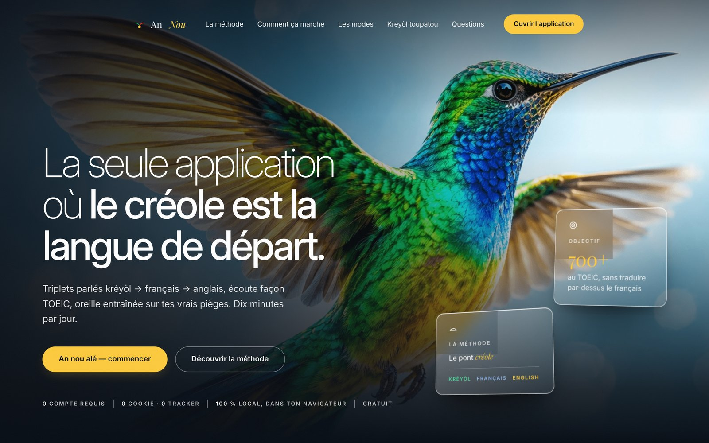
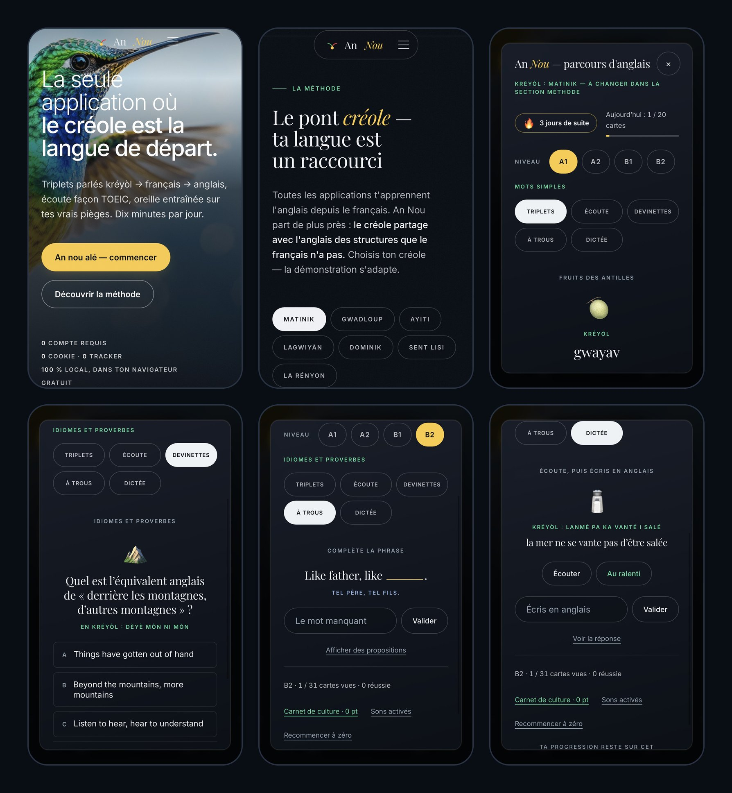
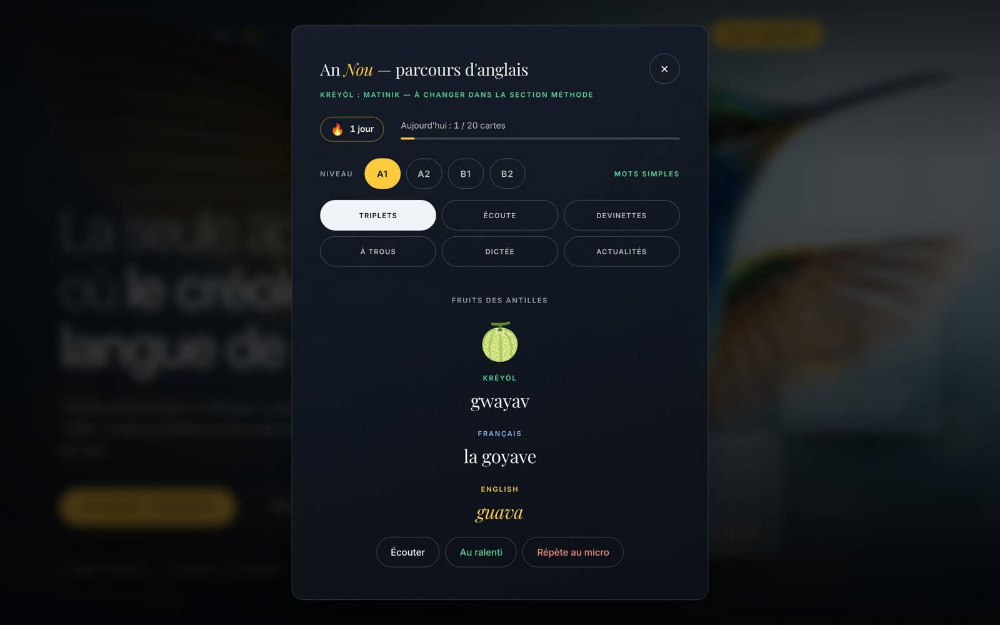

  

# An Nou

**Apprendre l'anglais en partant du créole.** An Nou est une application web gratuite qui part du kréyòl, passe par le français et arrive à l'anglais : c'est la méthode du pont.

## Ce que fait l'application

- **Triplets parlés** : chaque mot ou phrase en kréyòl, en français et en anglais, lu à voix haute, au ralenti si besoin
- **Prononciation au micro** : l'application écoute la réponse et vérifie la prononciation anglaise
- **Écoute façon TOEIC** : la question est prononcée, jamais affichée
- **Phrases à trous chronométrées**, sur le modèle de la partie 5 du TOEIC
- **Devinettes et dictée**
- **Proverbes créoles** et leur équivalent anglais, avec des repères culturels
- **Sept créoles** : Martinique, Guadeloupe, Dominique, Sainte-Lucie, Haïti, La Réunion et Guyane
- **Niveaux A1 à B2**, avec une série de jours et un objectif quotidien
- **Actualités** en français, traduites en anglais
- Gratuite, sans compte, sans cookie ni traceur, installable et utilisable hors ligne

## Captures

Sur téléphone :

  

Sur ordinateur :

  

## Technique

- HTML, CSS et JavaScript, sans framework ni dépendance
- Web Speech API pour la synthèse et la reconnaissance vocale, Web Audio API
- Application web installable (PWA) : service worker, manifeste et fonctionnement hors ligne
- Sécurité : politique CSP stricte et en-têtes HTTP (intégration dans d'autres sites bloquée, HTTPS forcé)
- Script Node.js qui récupère les actualités par flux RSS et les traduit avec l'API MyMemory
- Contenu pédagogique séparé du code, pour enrichir les exercices sans toucher à la logique

## Code source

Le code source est privé. Pour y accéder, contactez-moi sur [LinkedIn](https://www.linkedin.com/in/morgan-martial).

© 2026 Morgan Martial. Tous droits réservés.
